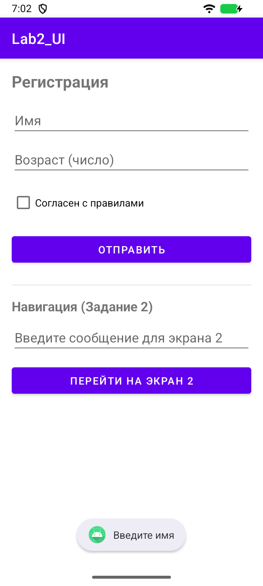
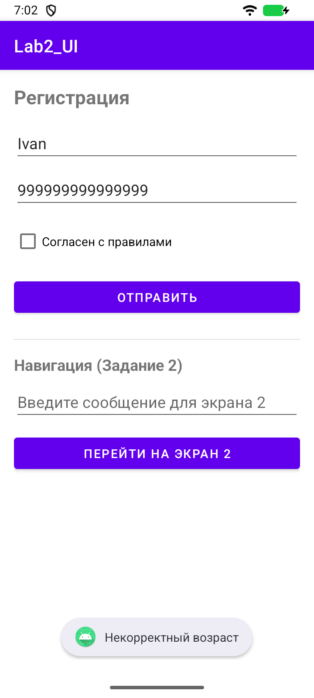
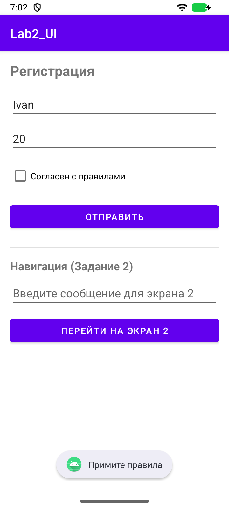
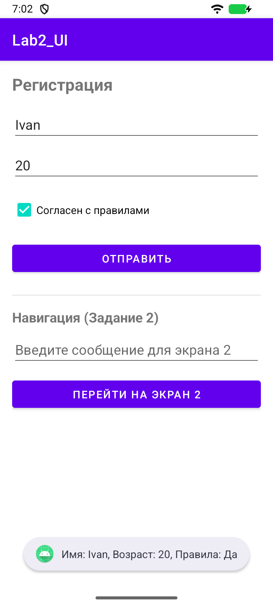
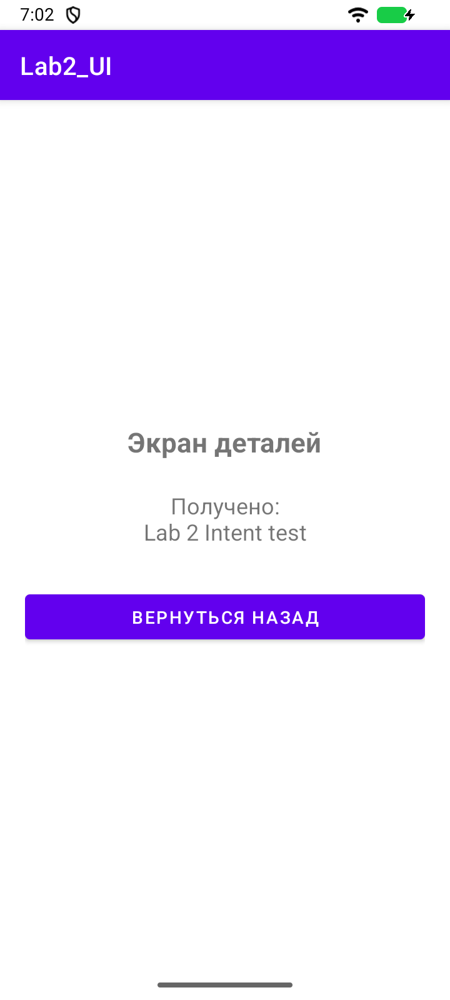
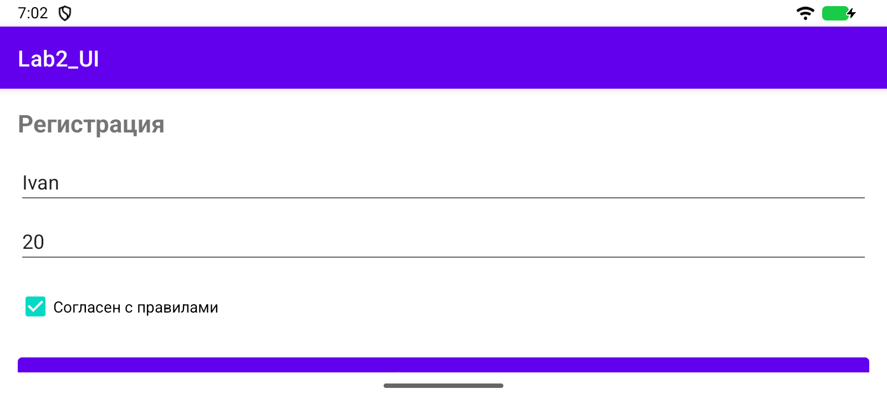

# Лабораторная работа 2

## Вёрстка формы и навигация между Activity

Студент: Ретунский Савелий. Проверка: 10 ноября 2026 года.

## Цель

Освоить XML-разметку, чтение полей формы, проверку возраста и передачу строки через Intent.

## Структура

MainActivity → Intent.putExtra("EXTRA_MESSAGE", text) → DetailActivity → getStringExtra() → TextView → finish() → MainActivity. Возврат обрабатывается Activity Result API.

## Реализация и исправления

1. ConstraintLayout содержит поля имени и возраста, CheckBox согласия и кнопку отправки. Возраст проверяется через toIntOrNull(), допустим диапазон 0–150. Ошибки и результат показываются Toast.

2. Пустое сообщение не отправляется. Ключ EXTRA_MESSAGE совпадает на обоих экранах; отсутствие extra обрабатывается значением по умолчанию.

3. Добавлены подтверждение возврата, прокрутка формы и учёт системных панелей/клавиатуры. Поля восстанавливаются стандартным сохранением состояния View.

## Проверка

Сборка `assembleDebug assembleDebugAndroidTest lintDebug`: успешно. Android Lint: 0 ошибок, 35 предупреждений. Предупреждения включают строки в XML вместо ресурсов, локализацию и рекомендации по зависимостям; они не скрыты baseline-файлом.

Эмулятор: Medium Phone, Android 16 API 36.1, x86_64. Тест `LabRegressionTest`: пройден. Исходник теста: [LabRegressionTest.kt](../app/src/androidTest/java/com/example/lab2_ui/LabRegressionTest.kt).

`connectedDebugAndroidTest` в этой Windows-среде не запустил Gradle Worker (`GradleWorkerMain` не найден). Те же собранные тестовые APK запускались через `adb shell am instrument -w …/androidx.test.runner.AndroidJUnitRunner`. Для повторения: `./verify.ps1 -DeviceTests` на отдельном эмуляторе. Скрипт очищает учебные данные приложения на эмуляторе.

Лог запуска:

```text
com.example.lab2_ui.LabRegressionTest:.

Time: 29.518

OK (1 test)
```

## Скриншоты сценариев

### 01-empty-name



### 02-invalid-age



### 03-missing-agreement



### 04-form-success



### 05-detail



### 06-landscape



## Фрагменты кода

### MainActivity.kt

[Полный исходник](../app/src/main/java/com/example/lab2_ui/MainActivity.kt)

```kotlin
btnSubmit.setOnClickListener {
            val name = etName.text.toString().trim()
            val ageText = etAge.text.toString().trim()
            val isAgreed = cbAgree.isChecked

            // Валидация полей
            if (name.isEmpty()) {
                Toast.makeText(this, "Введите имя", Toast.LENGTH_SHORT).show()
                return@setOnClickListener
            }

            if (ageText.isEmpty()) {
                Toast.makeText(this, "Введите возраст", Toast.LENGTH_SHORT).show()
                return@setOnClickListener
            }

            val age = ageText.toIntOrNull()
            if (age == null || age < 0 || age > 150) {
                Toast.makeText(this, "Некорректный возраст", Toast.LENGTH_SHORT).show()
                return@setOnClickListener
            }

            if (!isAgreed) {
                Toast.makeText(this, "Примите правила", Toast.LENGTH_SHORT).show()
                return@setOnClickListener
            }

            val resultMessage = "Имя: $name, Возраст: $age, Правила: ${if (isAgreed) "Да" else "Нет"}"
            Toast.makeText(this, resultMessage, Toast.LENGTH_LONG).show()
        }
```

### MainActivity.kt

[Полный исходник](../app/src/main/java/com/example/lab2_ui/MainActivity.kt)

```kotlin
btnGo.setOnClickListener {
            val text = etMessage.text.toString().trim()
            if (text.isEmpty()) {
                Toast.makeText(this, "Введите текст сообщения", Toast.LENGTH_SHORT).show()
                return@setOnClickListener
            }

            val intent = Intent(this, DetailActivity::class.java)
            intent.putExtra("EXTRA_MESSAGE", text)
            detailLauncher.launch(intent)
        }
```

### DetailActivity.kt

[Полный исходник](../app/src/main/java/com/example/lab2_ui/DetailActivity.kt)

```kotlin
override fun onCreate(savedInstanceState: Bundle?) {
        super.onCreate(savedInstanceState)
        setContentView(R.layout.activity_detail)

        tvResult = findViewById(R.id.tvResult)
        btnBack = findViewById(R.id.btnBack)

        // Получаем переданные данные из Intent
        val message = intent.getStringExtra("EXTRA_MESSAGE") ?: "Нет данных"
        tvResult.text = "Получено:\n$message"

        // Закрываем экран и возвращаемся назад
        btnBack.setOnClickListener {
            finish()
        }
    }
```

## Вывод

ConstraintLayout позволяет задавать взаимное положение элементов ограничениями, LinearLayout располагает их последовательно. Intent передаёт данные между Activity; finish() возвращает пользователя на предыдущий экран.
